

# Cyber Sunset

**A neon sunset theme for the [Azuriom](https://azuriom.com) CMS**

Full-screen artwork · animated light layer · vehicles on hologram circles · foldable-phone profile · live editor for administrators · light and dark mode

[**Get it on the Azuriom Market**](https://market.azuriom.com/resources/254)

**Limeris.fr by Sliver91** · [Discord support](https://discord.gg/4kV8pgC3Ck) · [limeris.fr](https://limeris.fr)

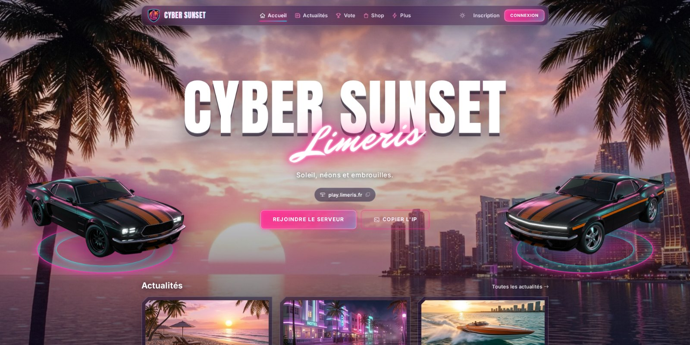

> **Premium theme.** This repository is a showcase only: it does not contain the theme files.
> Cyber Sunset is sold on the Azuriom Market: **[get it here](https://market.azuriom.com/resources/254)**. Questions before buying? Ask on [Discord](https://discord.gg/4kV8pgC3Ck).

---

## Highlights

| | |
|---|---|
| 🌅 **Cinematic home page** | A giant condensed title with a glowing handwritten word, the server address with one-click copy, and a light layer drawn by a small WebGL shader: haze on the horizon, sparkles on the water, floating lights, film grain. |
| 🚗 **Vehicles on hologram circles** | Original fastbacks, coupes, supercars and offshore boats on each side of the title, facing left or right. Upload your own picture straight from the settings. |
| 📱 **Foldable-phone pages** | Profile, login, register and cart shown inside an open foldable phone with a titanium frame and a hologram ring. |
| 🎛️ **Live editor for administrators** | A **Customize** side panel on every page, with an instant preview. |
| 🌗 **Light and dark mode** | Every block, page and effect switches with the visitor's choice. |
| 🧩 **6 headers · 6 footers** | Picked from preview cards, previewed live. |

---

## Live editor: the admin customize panel

Administrators (members allowed to manage themes) get a **Customize** button at the bottom left of every page. It opens a side column with four tabs (**Style**, **Header**, **Home**, **Footer**). Every change shows up on the page right away, before saving:

- main color and glow color (presets or any custom color);
- background picture, background darkening and block corners;
- header and footer styles, menu options;
- vehicles, effects, texts and which home page blocks are visible;
- footer columns and custom links.

**Save** stores the changes for everyone, **Cancel** brings the page back, and **All settings** opens the full settings page.

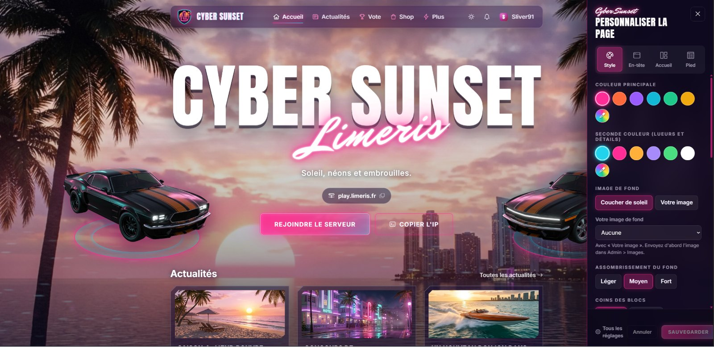

Visitors never see the button or the panel.

---

## Home page

<table>
<tr>
<td width="50%">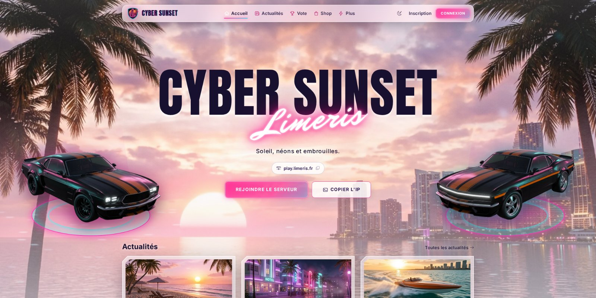 Light mode</td>
<td width="50%">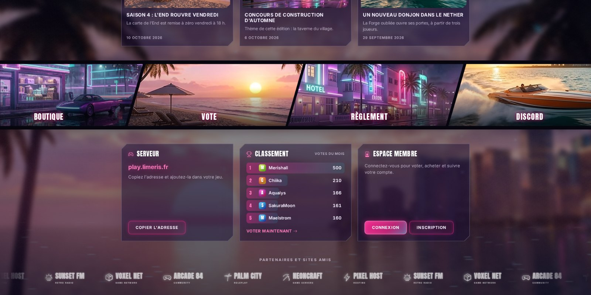 Slanted panels, server, ranking and member blocks, partners strip</td>
</tr>
<tr>
<td width="50%">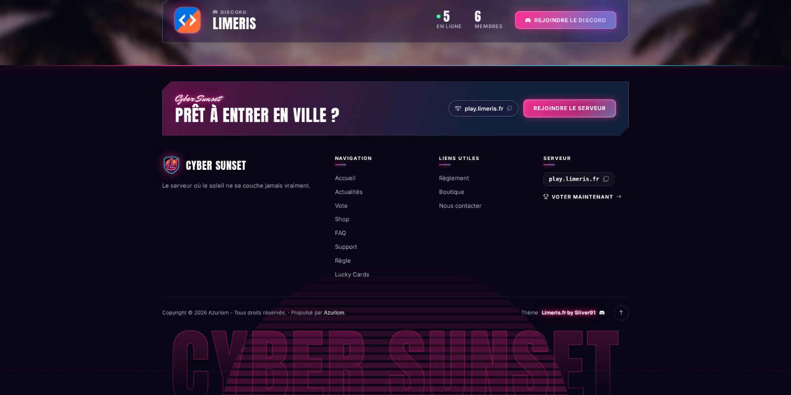 Discord block and retro footer</td>
<td width="50%" align="center">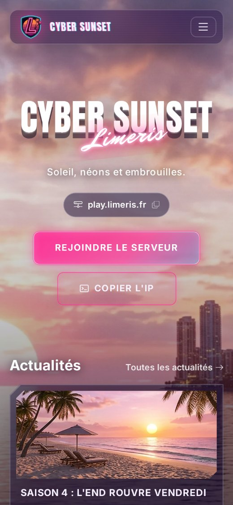 On a phone</td>
</tr>
</table>

- News cards in frosted glass with cut corners.
- Four slanted shortcut panels (shop, vote, rules, Discord…).
- Server, monthly vote ranking and member area blocks, each one optional.
- Discord block: server icon, members online, total members, join button.
- Scrolling partners strip, paused on hover.
- Footer with a call-to-action band, the site menu, your own links, the server status, a retro sun and grid.

---

## Themed pages

<table>
<tr>
<td width="50%">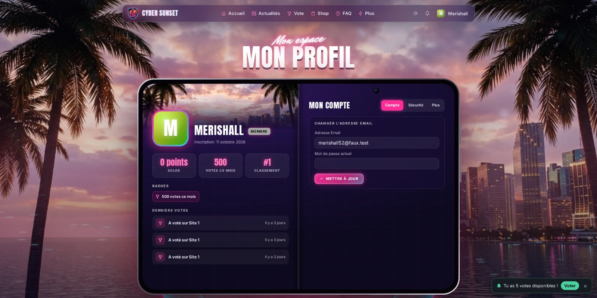 Profile: stats, badges and latest votes on the left, account settings on the right</td>
<td width="50%">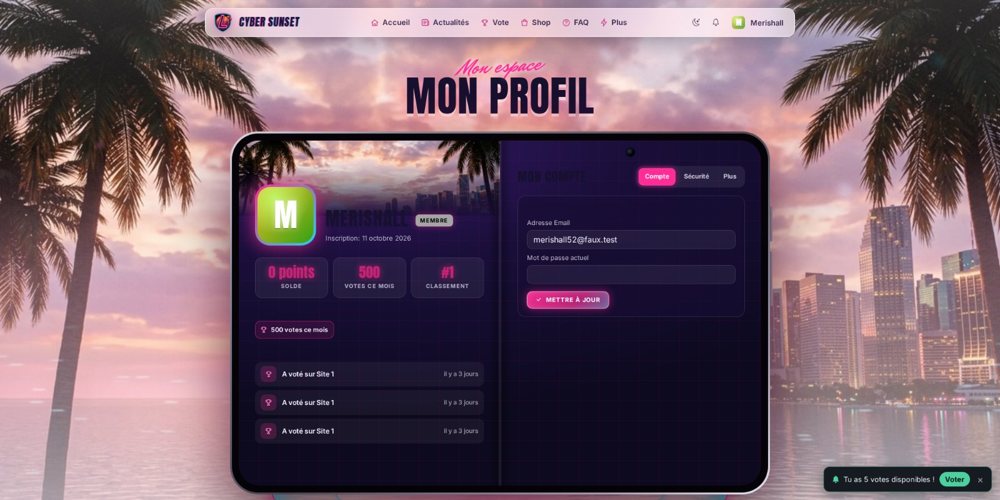 Profile, light mode</td>
</tr>
<tr>
<td width="50%">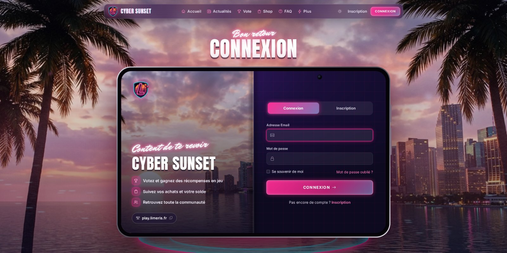 Login and register</td>
<td width="50%">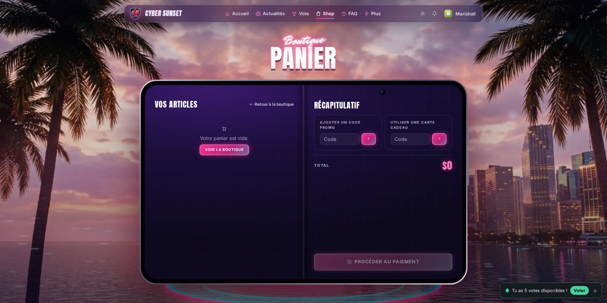 Cart</td>
</tr>
<tr>
<td width="50%">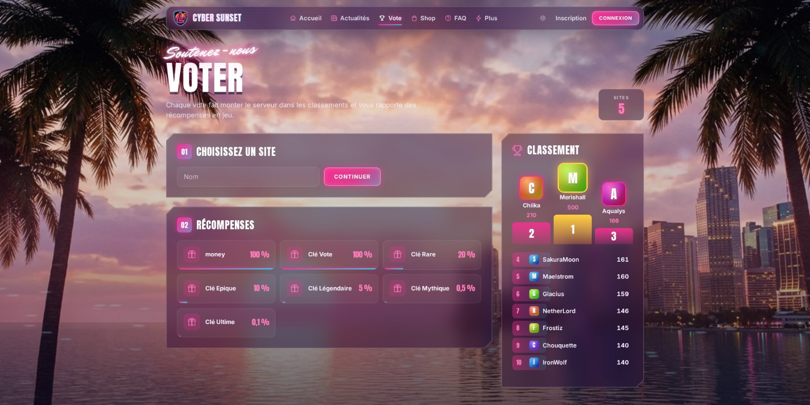 Vote: sites, rewards, podium and ranking</td>
<td width="50%">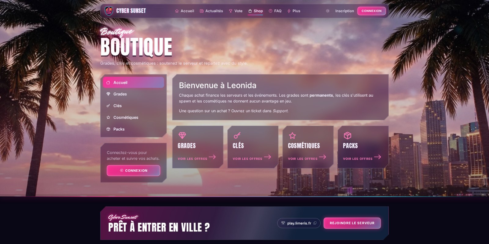 Shop: categories, packages, sale badges</td>
</tr>
<tr>
<td width="50%">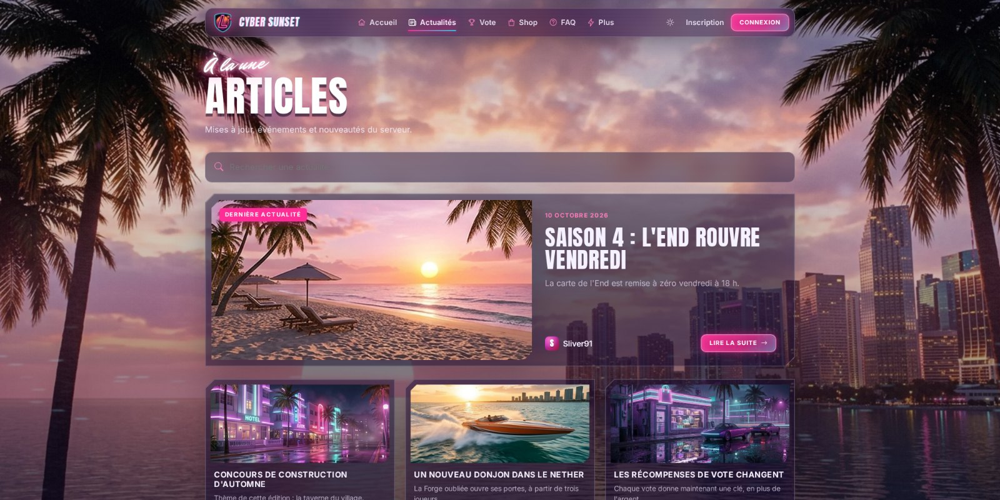 News</td>
<td width="50%">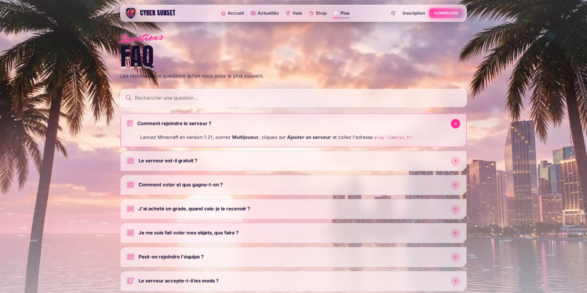 FAQ with search</td>
</tr>
<tr>
<td width="50%">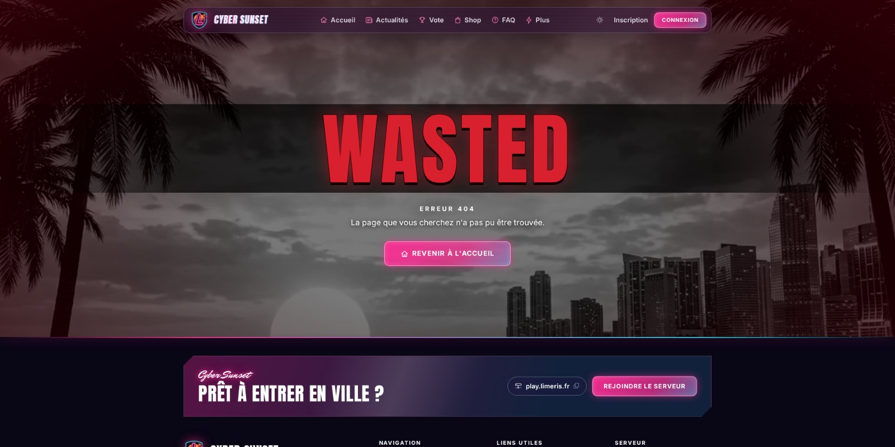 "Game over" 404 page</td>
<td width="50%">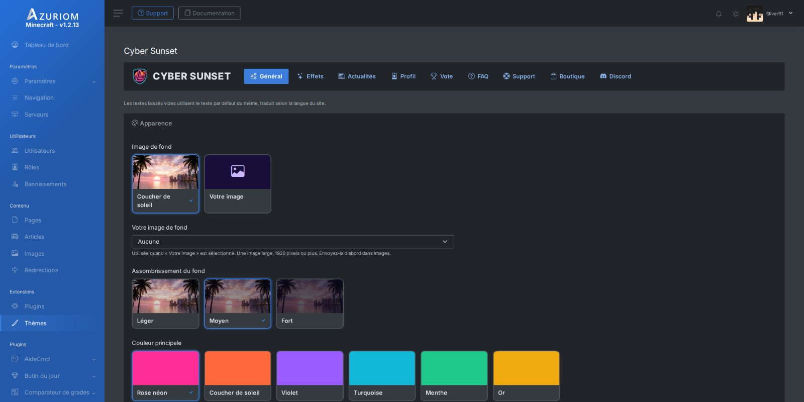 Settings page with tabs and picture cards</td>
</tr>
</table>

Each themed page can be switched back to the standard Azuriom page in the settings.

---

## Settings

- Tabs: General, Effects, News, Profile, Vote, FAQ, Support, Shop, Discord, all shown as picture cards.
- Background picture and darkening, main and second color, cut or rounded corners, every text and block.
- Effects: "address copied" notification (3 styles), VHS scanlines, glows, parallax, intro animations, seasonal effects (neon rain, snow, fireworks), retro interface sounds (off by default), loading screen.
- A pack of 32 neon icons, with menu icons guessed from link names.
- Light mode for low-power devices: never, always or automatic.
- Avatars: the picture the member uploaded, or a neon tile with their initial.

---

## Requirements

- Azuriom 1.2 or newer.
- Vote, Shop, Support and FAQ plugins are optional.
- Works with every game supported by Azuriom.
- No external dependency: fonts, pictures and scripts ship with the theme. Bootstrap 5 and Bootstrap Icons, no jQuery.
- Animations are skipped for visitors who asked for reduced motion.
- English and French.

---

## Support

Questions, bugs or ideas: **[Discord](https://discord.gg/4kV8pgC3Ck)**.

**Limeris.fr by Sliver91**

All pictures were made for this theme. Fonts: Anton, Mr Dafoe and Inter (SIL Open Font License 1.1).

